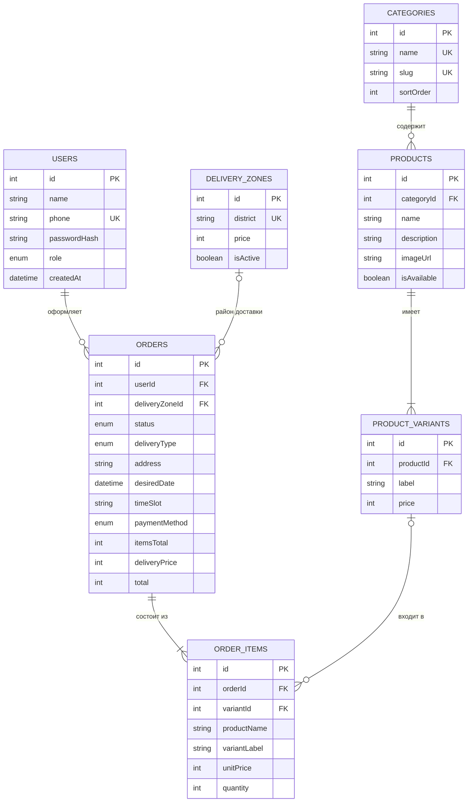
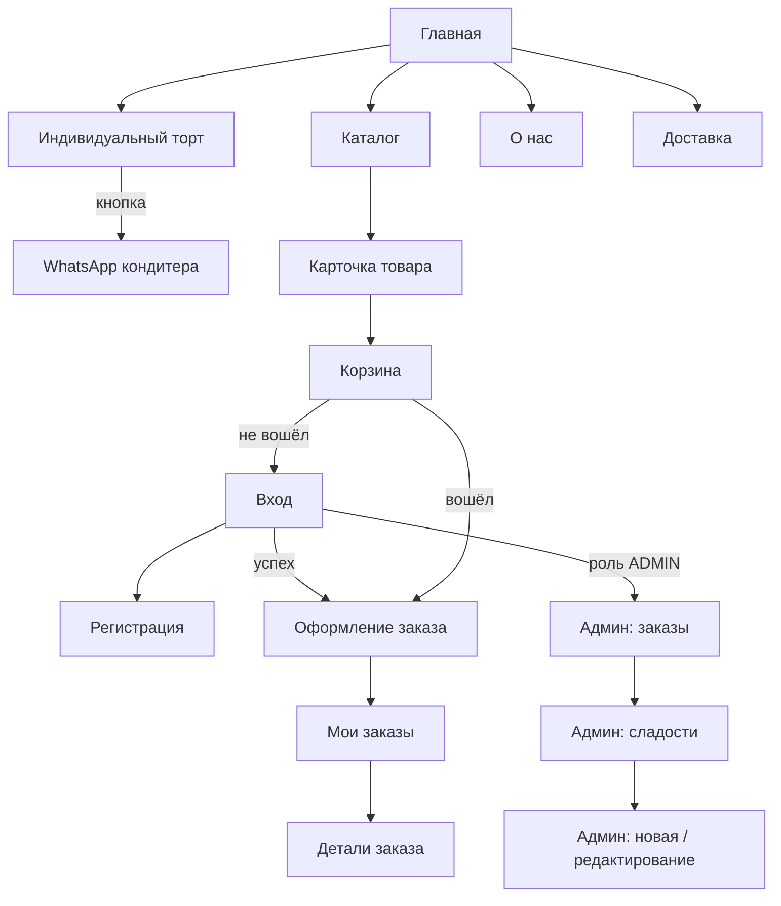

# QUIERO — архитектура проекта

Сайт небольшой кондитерской в Алматы (ул. Гоголя 167, Алмалинский район): каталог сладостей, заказы с доставкой или самовывозом, индивидуальные торты через WhatsApp.

**Стек:** React (Vite) + Node.js + Express + PostgreSQL + Prisma.

**Главный сценарий** (ради него существует сайт):

> Клиент выбирает торт → кладёт в корзину → оформляет заказ на дату → кондитер видит заказ и меняет статус → клиент видит статус.

Каждую функцию проверял вопрос: «Если её убрать, главный сценарий всё ещё работает?» Если да, функция не входит в MVP.

**Принятые допущения:**

- Оплата только при получении (наличными или переводом курьеру). Онлайн-оплата — в расширениях.
- Есть самовывоз с Гоголя 167 (бесплатно) и доставка по Алматы (от 1000 ₸, зависит от района).
- У каждой сладости есть варианты («1 кг», «2 кг», «набор 6 шт»), цена зависит от варианта.
- Категории и районы доставки заполняются начальными данными (`seed.js`), отдельной админки для них нет.
- Фото сладостей задаются ссылкой (администратор вставляет адрес картинки), загрузки файлов нет.
- Индивидуальный торт: страница с описанием, примерами и кнопкой «Обсудить с кондитером в WhatsApp». Формы и таблицы в базе нет.
- Корзина хранится в браузере, на сервер попадает только при оформлении заказа.

---

## 1. Пользователи и роли

| Роль | Кто это | Что может |
|---|---|---|
| **Гость** | Любой посетитель без входа | Смотреть каталог, карточки товаров, страницы «О нас», «Доставка», «Индивидуальный торт» (с кнопкой WhatsApp), собирать корзину, регистрироваться и входить |
| **Клиент** | Зарегистрированный по номеру телефона | Всё, что гость, плюс: оформлять заказы и видеть **только свои** заказы |
| **Администратор** | Владелец или кондитер | Всё, что клиент, плюс: управлять сладостями и их вариантами (добавлять, менять, скрывать), видеть все заказы и менять их статус |

Администратора создаёт `seed.js`, а не форма регистрации.

**Почему так:** роль хранится в таблице пользователей и проверяется на сервере. Если проверять роль только на сайте (скрыть кнопку «Админка»), любой, кто знает адрес API, сможет отправить запрос напрямую и изменить каталог.

---

## 2. MVP (минимальная первая версия)

### Что входит (7 функций)

1. **Каталог по категориям** и карточка товара с вариантами (1 кг / 2 кг) и ценой.
2. **Корзина** в браузере.
3. **Регистрация и вход** по номеру телефона и паролю.
4. **Оформление заказа:** самовывоз или доставка (с выбором района), дата, интервал времени, комментарий.
5. **Мои заказы** со статусами.
6. **Админ: заказы** и смена статуса.
7. **Админ: сладости и варианты** (добавить, изменить, скрыть; фото ссылкой).

Плюс три простые страницы почти без логики: «О нас», «Доставка» (таблица районов и цен читается из базы, только чтение), «Индивидуальный торт» (описание, примеры фото, кнопка WhatsApp со ссылкой `wa.me/номер?text=...`).

### Что НЕ входит и почему

| Не входит | Почему |
|---|---|
| Поиск по названию | В кондитерской 20–40 товаров, категорий хватает. Позже это один параметр запроса, база не меняется |
| Фильтры «без сахара» и «новинка» | Сценарий работает без них. Позже: два поля `Boolean` и один параметр запроса |
| Управление категориями в админке | Категорий 4–5, они почти не меняются, задаются в `seed.js` |
| Форма заявки на индивидуальный торт | Самая тяжёлая часть: своя таблица, загрузка файла, эндпоинты, страницы, статусы. А общение всё равно идёт в мессенджере, кнопка WhatsApp решает ту же задачу |
| Загрузка файлов (фото товара) | Отдельная тема (multer, проверки типа и размера, папка `uploads/`). В MVP фото вставляется ссылкой |
| Редактирование районов и цен доставки в админке | Районов мало, цены задаются в `seed.js` |
| Онлайн-оплата (Kaspi и т.д.) | Нужен договор с платёжным сервисом и отдельная безопасность. Хватает оплаты при получении |
| SMS-подтверждение номера | Платная услуга, сложная интеграция. Номер просто логин |
| Отмена заказа клиентом | Дополнительные правила по времени. Пока отмена через связь с кондитерской, статус `CANCELLED` ставит админ |
| Лимит заказов на день, минимальная сумма доставки | Не нужны для сценария. Если на одну субботу заказали слишком много, кондитер отменяет лишние (см. раздел 10) |
| Избранное, отзывы, промокоды, чат на сайте, уведомления в Telegram | «Приятные мелочи», на основной сценарий не влияют |

**Почему так:** один человек за несколько недель хорошо делает 5–7 функций. Лучше довести до конца 7, чем к защите иметь 10 сделанных наполовину. Всё, что убрано, добавляется позже без переделки структуры (раздел 10).

---

## 3. Пользовательские истории

| № | Роль | История | MVP |
|---|---|---|---|
| US1 | Гость | Как гость, я хочу смотреть каталог по категориям, чтобы выбрать сладости | ✅ |
| US2 | Гость | Как гость, я хочу искать по названию и фильтровать «без сахара» и «новинки», чтобы быстро найти нужное | ❌ |
| US3 | Гость | Как гость, я хочу открыть карточку товара с вариантами и ценой, чтобы решить, что заказать | ✅ |
| US4 | Гость | Как гость, я хочу видеть условия и цены доставки по районам, чтобы понять итоговую стоимость | ✅ |
| US5 | Гость | Как гость, я хочу зарегистрироваться по номеру телефона, чтобы делать заказы | ✅ |
| US6 | Клиент | Как клиент, я хочу войти по номеру и паролю, чтобы видеть свои заказы | ✅ |
| US7 | Клиент | Как клиент, я хочу добавлять сладости в корзину и менять количество, чтобы собрать заказ | ✅ |
| US8 | Клиент | Как клиент, я хочу оформить заказ с доставкой или самовывозом и выбрать дату и время, чтобы получить десерт вовремя | ✅ |
| US9 | Клиент | Как клиент, я хочу видеть список своих заказов и их статусы, чтобы знать, на каком этапе заказ | ✅ |
| US10 | Клиент | Как клиент, я хочу отменить заказ, пока он новый, чтобы не платить за ненужное | ❌ |
| US11 | Гость | Как гость, я хочу нажать кнопку на странице индивидуального торта и написать кондитеру в WhatsApp, чтобы обсудить торт со своей картинкой | ✅ |
| US12 | Администратор | Как администратор, я хочу добавлять, менять и скрывать сладости и их варианты, чтобы каталог был актуальным | ✅ |
| US13 | Администратор | Как администратор, я хочу видеть все заказы и менять их статус, чтобы клиент видел прогресс | ✅ |
| US14 | Администратор | Как администратор, я хочу видеть заявки на индивидуальные торты с картинками, чтобы связаться с клиентом | ❌ |
| US15 | Администратор | Как администратор, я хочу менять цены доставки по районам, чтобы подстраиваться под бизнес | ❌ |

---

## 4. Бизнес-правила

Правила, которые сервер проверяет **всегда**.

| № | Правило | Почему нельзя проверять только в браузере |
|---|---|---|
| R1 | **Цена считается на сервере** из базы (цена варианта × количество + доставка). Цены от клиента сервер игнорирует | В браузере цену можно подменить в DevTools и заказать торт за 1 ₸ |
| R2 | Нельзя заказать скрытый или недоступный товар (`isAvailable = false`) | Пока клиент держал корзину открытой, товар могли скрыть. Браузер об этом не знает |
| R3 | Клиент видит и открывает **только свои** заказы | Если запретить это только кнопками, достаточно поменять номер в адресе `/orders/45` на `/orders/46` и увидеть чужой заказ |
| R4 | Номер телефона уникален. Сервер сам приводит его к формату `+7XXXXXXXXXX`: `8 701 123 45 67` и `+7 (701) 123-45-67` превращаются в `+77011234567` | Две вкладки могут одновременно зарегистрировать один номер, а один человек может ввести его по-разному и зарегистрироваться дважды. Только сервер и база видят все номера сразу |
| R5 | Дата и время заказа: интервал выбирается из фиксированного списка (`10:00-12:00`, `12:00-14:00`, `14:00-16:00`, `16:00-18:00`), начало интервала не раньше чем через 24 часа **по времени Алматы** и не дальше чем через 60 дней | Дату и время в запросе можно подделать («25:99», «утром»). Кондитеру нужно время на выпечку, а часовой пояс браузера может отличаться от Алматы |
| R6 | Стоимость доставки берётся из таблицы районов. При самовывозе она 0, при доставке обязательны район и адрес | Клиент может отправить «доставка 0 ₸» в обход формы |
| R7 | Количество — целое число от 1 до 20, в заказе минимум одна позиция | Отправка `quantity: -5` ломает сумму заказа |
| R8 | Менять статус заказа может только администратор, и только по цепочке: NEW → CONFIRMED → PREPARING → READY → COMPLETED. Отмена (CANCELLED) — из NEW, CONFIRMED, PREPARING. **COMPLETED = заказ выдан и оплачен** (оплата при получении) | Клиент может сам отправить запрос «статус: COMPLETED» |
| R9 | Все админские действия (добавление и изменение сладостей, просмотр всех заказов, смена статуса) — только для роли ADMIN | Скрытая кнопка не защищает адрес API |
| R10 | Пароль не короче 8 символов, хранится только в виде хеша | Проверка в форме не защищает от прямых запросов к API |

---

## 5. База данных

PostgreSQL, доступ через Prisma. Деньги хранятся **целыми числами в тенге** (`Int`), без копеек.

**Почему так (деньги в Int):** если хранить цены как `Float`, суммы могут получиться 2999.9999999. Целые числа точные.

### 5.1 Таблицы (7)

**users** — пользователи

| Поле | Тип | Примечание |
|---|---|---|
| id | Int, PK | автоинкремент |
| name | String | имя |
| phone | String, unique | в формате `+77011234567` |
| passwordHash | String | хеш пароля, не сам пароль |
| role | enum `CLIENT` / `ADMIN` | по умолчанию CLIENT |
| createdAt | DateTime | |

**categories** — категории (заполняются в `seed.js`)

| Поле | Тип | Примечание |
|---|---|---|
| id | Int, PK | |
| name | String, unique | «Торты», «Корпусные десерты», «Макаронс» |
| slug | String, unique | для адреса: `korpusnye-deserty` |
| sortOrder | Int | порядок на сайте |

**products** — сладости

| Поле | Тип | Примечание |
|---|---|---|
| id | Int, PK | |
| categoryId | Int, FK → categories | |
| name | String | «Наполеон», «Молочная девочка» |
| description | String | состав, описание |
| imageUrl | String | обычная ссылка на фото, которую вводит админ |
| isAvailable | Boolean | скрыть без удаления |
| createdAt | DateTime | |

**product_variants** — варианты (размер, вес, количество)

| Поле | Тип | Примечание |
|---|---|---|
| id | Int, PK | |
| productId | Int, FK → products | |
| label | String | «1 кг», «набор 6 шт» |
| price | Int | цена в тенге |

У каждой сладости минимум один вариант. Цена хранится **только** здесь, на карточке показываем «от N ₸».

**delivery_zones** — районы доставки (заполняются в `seed.js`)

| Поле | Тип | Примечание |
|---|---|---|
| id | Int, PK | |
| district | String, unique | «Алмалинский», «Бостандыкский» и т.д. |
| price | Int | от 1000 ₸ |
| isActive | Boolean | |

**orders** — заказы

| Поле | Тип | Примечание |
|---|---|---|
| id | Int, PK | |
| userId | Int, FK → users | |
| status | enum | `NEW`, `CONFIRMED`, `PREPARING`, `READY`, `COMPLETED`, `CANCELLED` |
| deliveryType | enum | `DELIVERY` / `PICKUP` |
| deliveryZoneId | Int?, FK → delivery_zones | пусто при самовывозе |
| address | String? | пусто при самовывозе |
| recipientName | String | кто получает |
| recipientPhone | String | |
| desiredDate | DateTime | дата |
| timeSlot | String | интервал из списка в коде: «14:00-16:00» |
| comment | String? | |
| paymentMethod | enum | `ON_RECEIPT` (пока единственное значение) |
| itemsTotal | Int | сумма товаров |
| deliveryPrice | Int | стоимость доставки на момент заказа |
| total | Int | итого |
| createdAt | DateTime | |

**order_items** — позиции заказа

| Поле | Тип | Примечание |
|---|---|---|
| id | Int, PK | |
| orderId | Int, FK → orders | |
| variantId | **Int?**, FK → product_variants | необязательное: при удалении варианта поле становится пустым, а заказ не ломается |
| productName | String | название на момент заказа |
| variantLabel | String | |
| unitPrice | Int | цена на момент заказа |
| quantity | Int | |

### 5.2 Связи

| Связь | Тип |
|---|---|
| categories → products | один-ко-многим (в категории много сладостей) |
| products → product_variants | один-ко-многим |
| users → orders | один-ко-многим |
| delivery_zones → orders | один-ко-многим |
| orders → order_items | один-ко-многим |
| **orders ↔ product_variants** | **многие-ко-многим** через таблицу `order_items` (в заказе много вариантов, вариант есть в разных заказах) |

### 5.3 ER-диаграмма



### 5.4 Проверка: дублирование и расширяемость

**Дублирование.** В `order_items` и `orders` данные повторяются намеренно: название, цена, стоимость доставки и итог «замораживаются» на момент заказа. **Почему так:** если бы заказ ссылался только на текущую цену, то после повышения цены на наполеон все старые заказы показывали бы неправильные суммы. Остальное дублирования не содержит: цена только в `product_variants`, район и цена доставки только в `delivery_zones`, категория только в `categories`.

**Расширяемость.**

- Новая категория или сладость — просто новая строка, структура не меняется.
- Новая пометка («без сахара», «новинка», «веган») — новое поле `Boolean` в `products`, старые данные не страдают.
- Заявки на индивидуальные торты, оплата, отзывы — отдельные новые таблицы. Старые таблицы не ломаются (раздел 10).
- Статусы — `enum`: новый статус добавляется одной строкой в схеме.
- Индивидуальный торт позже сможет стать обычным заказом без правки структуры, потому что `order_items.variantId` необязательный, а название и цена хранятся в самой позиции.

---

## 6. API

Базовый адрес: `/api`. Ответы в формате JSON. Защищённые запросы отправляют заголовок `Authorization: Bearer <токен>`.

### 6.1 Таблица эндпоинтов

| № | Метод | Адрес | Что делает | Доступ | История |
|---|---|---|---|---|---|
| 1 | POST | `/api/auth/register` | Регистрация | гость | US5 |
| 2 | POST | `/api/auth/login` | Вход, выдаёт токен | гость | US6 |
| 3 | GET | `/api/auth/me` | Данные текущего пользователя | клиент, админ | US6 |
| 4 | GET | `/api/categories` | Список категорий | все | US1 |
| 5 | GET | `/api/products` | Список доступных сладостей (фильтр `?category=`) | все | US1 |
| 6 | GET | `/api/products/:id` | Карточка со всеми вариантами | все | US3 |
| 7 | GET | `/api/delivery-zones` | Районы и цены доставки | все | US4 |
| 8 | POST | `/api/orders` | Оформить заказ | клиент | US7, US8 |
| 9 | GET | `/api/orders/my` | Мои заказы | клиент | US9 |
| 10 | GET | `/api/orders/:id` | Один заказ (только свой, админу любой) | клиент, админ | US9 |
| 11 | GET | `/api/admin/products` | Все сладости, включая скрытые | админ | US12 |
| 12 | POST | `/api/admin/products` | Создать сладость с вариантами | админ | US12 |
| 13 | PATCH | `/api/admin/products/:id` | Изменить или скрыть сладость | админ | US12 |
| 14 | GET | `/api/admin/orders` | Все заказы (фильтр `?status=`) | админ | US13 |
| 15 | PATCH | `/api/admin/orders/:id/status` | Сменить статус заказа | админ | US13 |

Эндпоинт №11 нужен, чтобы администратор видел скрытые сладости и мог вернуть их в каталог: публичный список (№5) их не показывает (правило R2).

Для US2, US10, US14 и US15 (не входят в MVP) позже добавятся поиск и фильтры в №5, `PATCH /api/orders/:id/cancel`, заявки на торты и редактирование районов (раздел 10).

**Почему так (PATCH вместо DELETE для товаров):** сладость, которая уже была в заказах, нельзя просто удалять: пропадёт связь со старыми заказами. Поэтому скрываем через `isAvailable: false`.

### 6.2 Примеры запросов и ответов

**1. POST `/api/auth/register`**

```json
// запрос
{ "name": "Айгерим", "phone": "8 701 123 45 67", "password": "MyPass123" }
// ответ 201 (номер сервер привёл к единому формату)
{ "token": "eyJhbGci...", "user": { "id": 1, "name": "Айгерим", "phone": "+77011234567", "role": "CLIENT" } }
// ошибка 409
{ "error": "Этот номер уже зарегистрирован" }
```

**2. POST `/api/auth/login`**

```json
// запрос
{ "phone": "+77011234567", "password": "MyPass123" }
// ответ 200
{ "token": "eyJhbGci...", "user": { "id": 1, "name": "Айгерим", "role": "CLIENT" } }
// ошибка 401
{ "error": "Неверный номер или пароль" }
```

**3. GET `/api/auth/me`**

```json
// ответ 200
{ "id": 1, "name": "Айгерим", "phone": "+77011234567", "role": "CLIENT" }
```

**4. GET `/api/categories`**

```json
// ответ 200
[ { "id": 1, "name": "Торты", "slug": "torty" }, { "id": 2, "name": "Макаронс", "slug": "makarons" } ]
```

**5. GET `/api/products?category=torty`**

```json
// ответ 200
[ { "id": 3, "name": "Наполеон", "imageUrl": "https://example.com/napoleon.jpg", "minPrice": 9000 } ]
```

**6. GET `/api/products/3`**

```json
// ответ 200
{ "id": 3, "name": "Наполеон", "description": "Слоёный торт с заварным кремом",
  "category": { "id": 1, "name": "Торты" }, "imageUrl": "https://example.com/napoleon.jpg",
  "variants": [ { "id": 7, "label": "1 кг", "price": 9000 }, { "id": 8, "label": "2 кг", "price": 17000 } ] }
// ошибка 404
{ "error": "Товар не найден" }
```

**7. GET `/api/delivery-zones`**

```json
// ответ 200
[ { "id": 1, "district": "Алмалинский", "price": 1000 }, { "id": 2, "district": "Наурызбайский", "price": 2500 } ]
```

**8. POST `/api/orders`** (клиент **не** присылает цены, их считает сервер)

```json
// запрос
{ "items": [ { "variantId": 7, "quantity": 1 } ],
  "deliveryType": "DELIVERY", "deliveryZoneId": 1, "address": "ул. Абая 10, кв. 5",
  "recipientName": "Айгерим", "recipientPhone": "+77011234567",
  "desiredDate": "2026-12-20", "timeSlot": "14:00-16:00", "comment": "Без орехов" }
// ответ 201
{ "id": 45, "status": "NEW", "itemsTotal": 9000, "deliveryPrice": 1000, "total": 10000 }
// ошибка 400
{ "error": "Выбранное время слишком близкое: минимум за 24 часа" }
```

**9. GET `/api/orders/my`**

```json
// ответ 200
[ { "id": 45, "status": "NEW", "total": 10000, "desiredDate": "2026-12-20", "timeSlot": "14:00-16:00" } ]
```

**10. GET `/api/orders/45`**

```json
// ответ 200
{ "id": 45, "status": "NEW", "deliveryType": "DELIVERY", "address": "ул. Абая 10, кв. 5",
  "desiredDate": "2026-12-20", "timeSlot": "14:00-16:00",
  "items": [ { "productName": "Наполеон", "variantLabel": "1 кг", "unitPrice": 9000, "quantity": 1 } ],
  "itemsTotal": 9000, "deliveryPrice": 1000, "total": 10000 }
// ошибка 403
{ "error": "Это не ваш заказ" }
```

**11. GET `/api/admin/products`**

```json
// ответ 200
[ { "id": 3, "name": "Наполеон", "category": "Торты", "isAvailable": true,
    "variants": [ { "id": 7, "label": "1 кг", "price": 9000 } ] },
  { "id": 20, "name": "Молочная девочка", "category": "Торты", "isAvailable": false, "variants": [] } ]
```

**12. POST `/api/admin/products`**

```json
// запрос (обычный JSON, фото ссылкой)
{ "name": "Молочная девочка", "description": "Нежный медовый торт со сметанным кремом",
  "categoryId": 1, "imageUrl": "https://example.com/milk-girl.jpg",
  "variants": [ { "label": "1 кг", "price": 9000 } ] }
// ответ 201
{ "id": 20, "name": "Молочная девочка", "isAvailable": true }
```

**13. PATCH `/api/admin/products/20`**

```json
// запрос (скрыть товар)
{ "isAvailable": false }
// ответ 200
{ "id": 20, "isAvailable": false }
```

**14. GET `/api/admin/orders?status=NEW`**

```json
// ответ 200
[ { "id": 45, "client": { "name": "Айгерим", "phone": "+77011234567" }, "status": "NEW",
    "total": 10000, "desiredDate": "2026-12-20", "timeSlot": "14:00-16:00" } ]
```

**15. PATCH `/api/admin/orders/45/status`**

```json
// запрос
{ "status": "CONFIRMED" }
// ответ 200
{ "id": 45, "status": "CONFIRMED" }
// ошибка 400
{ "error": "Нельзя перейти из COMPLETED в NEW" }
```

Общие коды ошибок: `400` — неверные данные, `401` — не вошёл, `403` — нет прав, `404` — не найдено, `409` — конфликт (например, номер уже занят).

---

## 7. Страницы

### Гость

| Страница | Адрес |
|---|---|
| Главная | `/` |
| Каталог (по категориям) | `/catalog` |
| Карточка товара | `/catalog/:id` |
| Индивидуальный торт (текст, примеры, кнопка WhatsApp) | `/custom-cake` |
| О нас | `/about` |
| Доставка | `/delivery` |
| Корзина | `/cart` |
| Вход | `/login` |
| Регистрация | `/register` |

### Клиент (всё выше, плюс)

| Страница | Адрес |
|---|---|
| Оформление заказа | `/checkout` |
| Мои заказы | `/account/orders` |
| Детали заказа | `/account/orders/:id` |

### Администратор

| Страница | Адрес |
|---|---|
| Заказы | `/admin/orders` |
| Сладости | `/admin/products` |
| Новая сладость | `/admin/products/new` |
| Редактирование сладости | `/admin/products/:id/edit` |

Итого 16 страниц, из них несколько почти без логики: «О нас», «Доставка», «Индивидуальный торт».

### Карта переходов



**Почему так:** страницы клиента и администратора закрыты и на сайте (переадресация на вход), и на сервере (проверка токена в API). Только сайт — недостаточно: данные всё равно можно запросить напрямую.

---

## 8. Структура папок

```
quiero/
├── README.md
├── docs/
│   └── architecture.md
├── client/                      # сайт (React + Vite)
│   ├── index.html
│   ├── package.json
│   ├── vite.config.js
│   ├── .env                     # VITE_API_URL, VITE_WHATSAPP_PHONE
│   └── src/
│       ├── main.jsx
│       ├── App.jsx
│       ├── api/                 # функции запросов к серверу
│       ├── components/          # кнопки, карточки, шапка, форма
│       ├── context/             # AuthContext (вход), CartContext (корзина)
│       ├── pages/               # страницы из раздела 7
│       │   └── admin/
│       ├── routes/              # защита маршрутов по роли
│       └── styles/
└── server/                      # сервер (Node.js + Express)
    ├── package.json
    ├── .env                     # секреты (не в git)
    ├── .env.example             # пример без секретов
    ├── prisma/
    │   ├── schema.prisma        # описание таблиц
    │   └── seed.js              # категории, районы доставки, администратор
    └── src/
        ├── app.js               # настройка Express
        ├── server.js            # запуск
        ├── routes/              # адреса
        ├── controllers/         # приём запроса и ответ
        ├── services/            # бизнес-правила из раздела 4
        ├── database/            # подключение Prisma (prismaClient.js)
        ├── middleware/          # проверка токена, роли, ошибки
        └── utils/               # проверка данных, телефон, интервалы времени
```

### Слои сервера

Путь запроса: **routes → controllers → services → database**.

| Слой | За что отвечает |
|---|---|
| **routes** | Знает адреса (`/api/orders`) и кто туда может заходить, передаёт запрос контроллеру |
| **controllers** | Достаёт данные из запроса, вызывает сервис, возвращает ответ с нужным кодом |
| **services** | Бизнес-правила (R1–R10): пересчёт цен, проверка дат, цепочка статусов |
| **database** | Единственное место, где сервер общается с PostgreSQL (через Prisma) |

**Почему так:** если все правила написать прямо в маршрутах, код превращается в кашу, и при каждом изменении правила (например, срок заказа) придётся искать его по всему проекту. В слое `services` каждое правило лежит в одном месте.

---

## 9. Безопасность

**Пароли.** Пароль никогда не хранится как есть. Сервер превращает его в хеш (необратимый «отпечаток» пароля) библиотекой `bcrypt` и хранит в `passwordHash`. При входе хеш введённого пароля сравнивается с сохранённым. *Если хранить пароли открытым текстом, то при утечке базы все аккаунты окажутся взломаны.*

**Вход (JWT).** JWT — это подписанная «пропускная карточка» с `userId`, `role` и сроком действия (7 дней). После входа сервер выдаёт токен, сайт хранит его и отправляет в заголовке `Authorization: Bearer ...`. Сервер проверяет подпись секретным ключом и по токену знает, кто это. *Подделать токен без ключа нельзя, а сервер не хранит сессии в памяти.*

**Файл `.env`** (в `.gitignore`, в репозиторий не попадает). Сервер:

| Переменная | Что это |
|---|---|
| `DATABASE_URL` | Строка подключения к PostgreSQL (с паролем) |
| `JWT_SECRET` | Секретный ключ для подписи токенов |
| `PORT` | Порт сервера |
| `CLIENT_URL` | Адрес сайта для CORS (разрешённый источник запросов) |
| `ADMIN_PHONE`, `ADMIN_PASSWORD` | Данные, с которыми `seed.js` создаёт администратора (пароль не пишется в код) |

Сайт (`client/.env`): `VITE_API_URL` (адрес сервера) и `VITE_WHATSAPP_PHONE` (номер для кнопки WhatsApp, он и так публичный). Рядом лежит `.env.example` с теми же именами, но без значений.

**Проверки доступа (middleware — промежуточные функции, которые срабатывают до контроллера):**

1. `requireAuth` — проверяет токен. Нет токена или он подделан → `401`.
2. `requireRole('ADMIN')` — проверяет роль. Клиент в админском адресе → `403`.
3. Проверка владельца — в сервисе заказа: `order.userId === req.user.id`, иначе `403`.

**Дополнительно:**

- Проверка входных данных на сервере (например, библиотека `zod`): типы, длины, формат телефона, интервал времени.
- `helmet` (защитные заголовки) и `express-rate-limit` на вход и регистрацию (ограничение попыток, защита от подбора пароля).
- Prisma сама защищает от SQL-инъекций (подстановки вредного SQL через поля формы).
- Администратора создаёт `seed.js`, а не форма регистрации. Роль нельзя передать в запросе регистрации.
- Ссылка на фото, которую вводит админ, выводится в ``, а не вставляется как HTML. Принимаются только адреса, начинающиеся с `https://`.
- Токен лежит в `localStorage` — это просто для учебного проекта. Минус: его может прочитать вредоносный скрипт на странице, поэтому на сайте нельзя вставлять пользовательский текст как HTML (React это по умолчанию экранирует).

---

## 10. Расширение

Всё, что не вошло в MVP, добавляется без переделки основы. Ниже — что изменится в архитектуре для каждой функции.

### 1. Заявка на индивидуальный торт (форма, картинка, статусы)

**Что изменится:** новая таблица `custom_requests` (клиент, описание, дата, ссылка на картинку, статус `NEW` / `IN_CHAT` / `DONE` / `REJECTED`), четыре эндпоинта (создать заявку, мои заявки, список и смена статуса для админа), три страницы (форма, мои заявки, админка заявок). Старые таблицы не меняются.

**Заложено сейчас:** `order_items.variantId` необязательный, а название и цена хранятся прямо в позиции. Поэтому позже кондитер сможет превратить согласованную заявку в обычный заказ с произвольной ценой, добавив в `custom_requests` необязательное поле `orderId`. Переписывать оформление заказа не придётся.

### 2. Поиск и фильтры («без сахара», «новинка»)

**Что изменится:** в `products` добавляются два поля `Boolean` (`isNew`, `isSugarFree`), в `GET /api/products` добавляются параметры `search`, `sugarFree`, `isNew`, на странице каталога появляются поле поиска и переключатели. Структура остальных таблиц не меняется.

### 3. Загрузка фото

**Что изменится:** в сервер добавляется библиотека `multer` и папка `uploads/`, админские запросы создания и изменения сладости становятся `multipart/form-data`, а правило проверки файла (только JPG/PNG/WEBP, до 5 МБ, имя файла генерирует сервер) добавляется к бизнес-правилам. Поле `imageUrl` остаётся тем же, в него просто попадает путь к загруженному файлу.

### 4. Лимит заказов на день

**Что изменится:** в код (или в отдельную таблицу настроек) добавляется `max_orders_per_day`, а при оформлении заказа сервис считает заказы на выбранную дату и отказывает при превышении. **Сейчас:** кондитер вручную отменяет лишние заказы (статус `CANCELLED`).

### 5. Онлайн-оплата (Kaspi и др.)

**Что изменится:** появляется таблица `payments` (заказ, сумма, статус, id платежа во внешней системе), в `orders` добавляется поле `paymentStatus`, и два эндпоинта: создание платежа и приём подтверждения от платёжной системы. Старые заказы остаются как есть, поле `paymentMethod` уже есть.

### 6. Уведомления кондитеру в Telegram

**Что изменится:** добавляется небольшой модуль, который отправляет сообщение через Telegram-бота при новом заказе.

**Заложено сейчас:** вся логика создания заказа лежит в `services/orderService`. Модуль уведомлений вызывается одной строкой в конце этой функции, контроллеры и маршруты не меняются. Если бы код создания заказа был размазан по маршрутам, пришлось бы править его в нескольких местах.

### 7. Отмена заказа клиентом и минимальная сумма доставки

**Что изменится:** добавляется эндпоинт `PATCH /api/orders/:id/cancel` с проверкой «только свой заказ и только в статусе NEW». Для минимальной суммы в `delivery_zones` добавляется поле `minOrderTotal`, и проверка в сервисе заказа. Структура остальных таблиц не меняется.

---

## Вопросы на защите

**1. Почему цену заказа считает сервер, а не сайт?**
Потому что браузер контролирует пользователь: он может подменить цену в запросе. Сервер берёт цены из базы и сам считает сумму, поэтому изменить её невозможно.

**2. Зачем в `order_items` хранить название и цену, если они уже есть в `products` и `product_variants`?**
Цены меняются. Если заказ будет ссылаться только на текущую цену, старые заказы покажут неправильные суммы. Копия фиксирует данные на момент покупки.

**3. Какая связь между заказами и сладостями и как она реализована?**
Многие-ко-многим: в заказе много позиций, а сладость может быть в разных заказах. В реляционной базе это реализуется промежуточной таблицей `order_items`.

**4. Как сервер понимает, кто делает запрос, и чем клиент отличается от администратора?**
При входе сервер выдаёт JWT-токен с `userId` и `role`, подписанный секретным ключом. На каждом защищённом запросе middleware проверяет подпись и роль. Подделать токен без ключа нельзя.

**5. Зачем делить сервер на routes, controllers, services и database?**
Чтобы у каждого слоя была одна задача. Правила бизнеса лежат только в `services`, поэтому их легко найти и изменить, не трогая адреса и работу с базой. Так же проще проверять и расширять проект.

**6. Почему заявку на индивидуальный торт убрали из MVP, если это важная услуга кондитерской?**
Общение с кондитером всё равно идёт в WhatsApp. Кнопка со ссылкой решает ту же задачу без своей таблицы, загрузки файлов и админки. Форму можно добавить позже, структура для этого уже подготовлена.

**7. Что будет, если два клиента закажут 30 тортов на одну субботу?**
В MVP кондитер отменит лишние заказы (статус `CANCELLED`). Лимит заказов на день добавляется в расширении как одна проверка в сервисе заказа.
