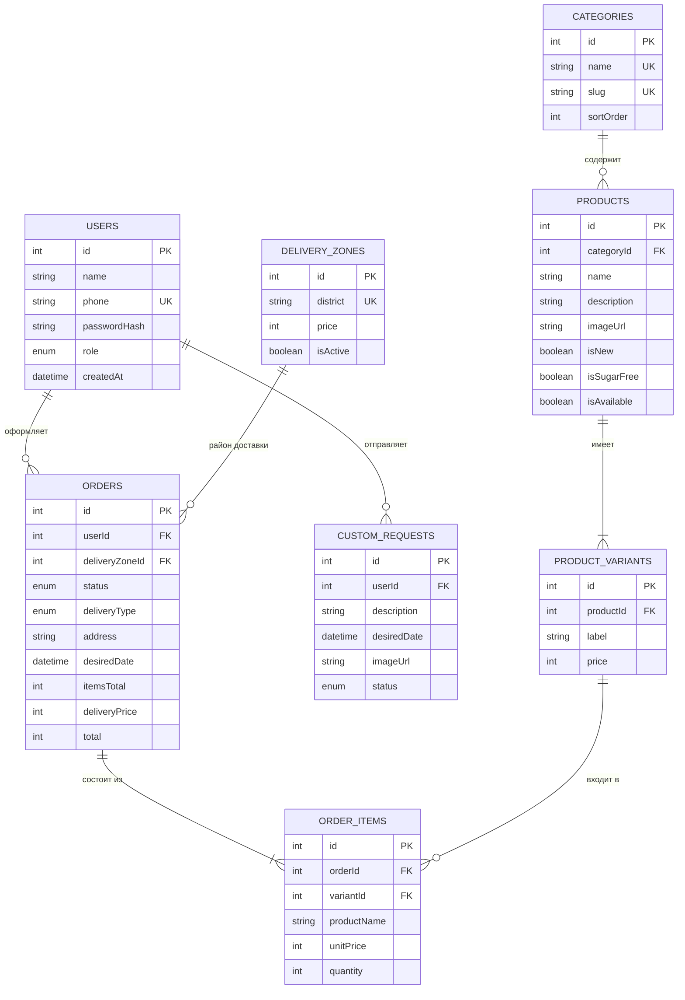
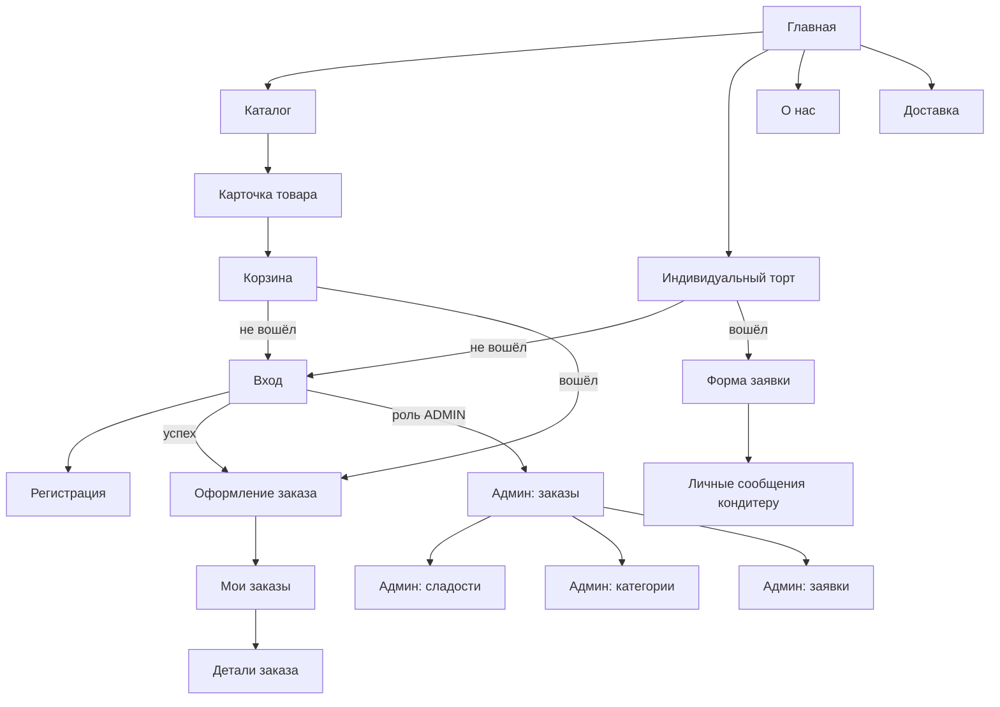

# QUIERO — архитектура проекта

Сайт небольшой кондитерской в Алматы (ул. Гоголя 167, Алмалинский район): каталог сладостей, заказы с доставкой, заявки на индивидуальные торты.

**Стек:** React (Vite) + Node.js + Express + PostgreSQL + Prisma.

**Принятые допущения** (если что-то не так — поменяем до начала кода):

- Оплата только при получении (наличными или переводом курьеру). Онлайн-оплата — в расширениях.
- Есть самовывоз с Гоголя 167 (бесплатно) и доставка по Алматы (от 1000 ₸, зависит от района).
- У каждой сладости есть варианты размера/количества («1 кг», «набор 6 шт» и т.д.), цена зависит от варианта.
- Индивидуальный торт: клиент оставляет заявку на сайте, дальше общение с кондитером идёт в личных сообщениях (WhatsApp или Telegram). Чата внутри сайта нет.
- Корзина хранится в браузере, на сервер попадает только при оформлении заказа.

---

## 1. Пользователи и роли

| Роль | Кто это | Что может |
|---|---|---|
| **Гость** | Любой посетитель без входа | Смотреть каталог, карточки товаров, страницы «О нас» и «Доставка», собирать корзину, регистрироваться и входить |
| **Клиент** | Зарегистрированный по номеру телефона | Всё, что гость, плюс: оформлять заказы, видеть **только свои** заказы, отправлять заявку на индивидуальный торт |
| **Администратор** | Владелец или кондитер | Всё, что клиент, плюс: управлять каталогом (добавлять, менять, скрывать сладости), видеть все заказы и менять их статус, видеть заявки на индивидуальные торты |

**Почему так:** роль хранится в таблице пользователей и проверяется на сервере. Если проверять роль только на сайте (скрыть кнопку «Админка»), любой, кто знает адрес API, сможет отправить запрос напрямую и изменить каталог.

---

## 2. MVP (минимальная первая версия)

### Что входит

1. Каталог с категориями и фильтрами («без сахара», «новинка»), поиск по названию.
2. Карточка товара с вариантами (размер/вес) и ценой.
3. Регистрация и вход по номеру телефона и паролю.
4. Корзина (в браузере).
5. Оформление заказа: доставка (с выбором района) или самовывоз, желаемая дата и время, комментарий.
6. Личный кабинет: список моих заказов и их статусы.
7. Карточка «Индивидуальный торт»: форма заявки (описание, дата, картинка) и переход в личные сообщения к кондитеру.
8. Админ-панель: управление сладостями и категориями, заказами (смена статуса), заявками на индивидуальные торты.

Плюс статические страницы «О нас» и «Доставка» (таблица районов и цен берётся из базы).

### Что НЕ входит и почему

| Не входит | Почему |
|---|---|
| Онлайн-оплата (Kaspi и т.д.) | Нужен договор с платёжным сервисом и отдельная безопасность. Для диплома достаточно оплаты при получении |
| SMS-подтверждение номера | Платная услуга, сложная интеграция. В MVP номер просто логин |
| Отмена заказа клиентом | Это дополнительные правила по времени. Пока отмена через связь с кондитерской |
| Избранное, отзывы, промокоды | Это «приятные мелочи», на основной сценарий заказа не влияют |
| Чат внутри сайта | Сложно (реальное время). Личные сообщения в мессенджере уже решают задачу |
| Редактирование цен доставки в админке | Районов мало, цены на старте задаются начальными данными (seed) в базе |
| Уведомления кондитеру в Telegram | Вынесено в расширения |

**Почему так:** до марта ты делаешь проект одна. Лучше довести до конца 8 функций, чем недоделать 15. Всё, что ушло из MVP, можно добавить позже, структура базы это позволяет (раздел 10).

---

## 3. Пользовательские истории

| № | Роль | История | MVP |
|---|---|---|---|
| US1 | Гость | Как гость, я хочу смотреть каталог по категориям, чтобы выбрать сладости | ✅ |
| US2 | Гость | Как гость, я хочу фильтровать «без сахара» и «новинки», чтобы быстро найти нужное | ✅ |
| US3 | Гость | Как гость, я хочу открыть карточку товара с вариантами и ценой, чтобы решить, что заказать | ✅ |
| US4 | Гость | Как гость, я хочу видеть условия и цены доставки по районам, чтобы понять итоговую стоимость | ✅ |
| US5 | Гость | Как гость, я хочу зарегистрироваться по номеру телефона, чтобы делать заказы | ✅ |
| US6 | Клиент | Как клиент, я хочу войти по номеру и паролю, чтобы видеть свои заказы | ✅ |
| US7 | Клиент | Как клиент, я хочу добавлять сладости в корзину и менять количество, чтобы собрать заказ | ✅ |
| US8 | Клиент | Как клиент, я хочу оформить заказ с доставкой или самовывозом и выбрать дату, чтобы получить десерт к нужному времени | ✅ |
| US9 | Клиент | Как клиент, я хочу видеть список своих заказов и их статусы, чтобы знать, на каком этапе заказ | ✅ |
| US10 | Клиент | Как клиент, я хочу отменить заказ, пока он новый, чтобы не платить за ненужное | ❌ |
| US11 | Клиент | Как клиент, я хочу оставить заявку на индивидуальный торт с картинкой и перейти в личные сообщения к кондитеру, чтобы обсудить детали | ✅ |
| US12 | Администратор | Как администратор, я хочу добавлять, менять и скрывать сладости и категории, чтобы каталог был актуальным | ✅ |
| US13 | Администратор | Как администратор, я хочу видеть все заказы и менять их статус, чтобы клиент видел прогресс | ✅ |
| US14 | Администратор | Как администратор, я хочу видеть заявки на индивидуальные торты, чтобы связаться с клиентом | ✅ |
| US15 | Администратор | Как администратор, я хочу менять цены доставки по районам, чтобы подстраиваться под бизнес | ❌ |

---

## 4. Бизнес-правила

Правила, которые сервер проверяет **всегда**.

| № | Правило | Почему нельзя проверять только в браузере |
|---|---|---|
| R1 | **Цена считается на сервере** из базы (цена варианта × количество + доставка). Цены от клиента сервер игнорирует | В браузере цену можно подменить в DevTools и заказать торт за 1 ₸ |
| R2 | Нельзя заказать скрытый или недоступный товар (`isAvailable = false`) | Пока клиент держал корзину открытой, товар могли скрыть. Браузер об этом не знает |
| R3 | Клиент видит и открывает **только свои** заказы | Если запретить это только кнопками, достаточно поменять номер в адресе `/orders/45` на `/orders/46` и увидеть чужой заказ |
| R4 | Номер телефона уникален и приведён к формату `+7XXXXXXXXXX` | Две вкладки могут одновременно зарегистрировать один номер. Только база и сервер видят все номера сразу |
| R5 | Желаемая дата заказа: не раньше чем через 24 часа (для индивидуальных тортов — через 3 дня) и не дальше чем через 60 дней | Дату в запросе можно подделать. Кондитеру нужно время на выпечку |
| R6 | Стоимость доставки берётся из таблицы районов. При самовывозе она 0, при доставке обязательны район и адрес | Клиент может отправить «доставка 0 ₸» в обход формы |
| R7 | Количество — целое число от 1 до 20, в заказе минимум одна позиция | Отправка `quantity: -5` ломает сумму заказа |
| R8 | Менять статус заказа может только администратор, и только по цепочке: NEW → CONFIRMED → PREPARING → READY → COMPLETED (отмена CANCELLED — из NEW/CONFIRMED/PREPARING) | Клиент может сам отправить запрос «статус: COMPLETED» |
| R9 | Все админские действия (CRUD товаров и категорий, заказы, заявки) — только для роли ADMIN | Скрытая кнопка не защищает адрес API |
| R10 | Загрузка картинок: только JPG/PNG/WEBP, не больше 5 МБ, имя файла генерирует сервер | В загрузку можно отправить вредоносный файл, подменив расширение. Браузерная проверка обходится одним запросом |
| R11 | Пароль не короче 8 символов, хранится только в виде хеша | Проверка в форме не защищает от прямых запросов к API |

---

## 5. База данных

PostgreSQL, доступ через Prisma. Деньги хранятся **целыми числами в тенге** (`Int`), без копеек.

**Почему так (деньги в Int):** если хранить цены как `Float`, суммы могут получиться 2999.9999999. Целые числа точные.

### 5.1 Таблицы

**users** — пользователи

| Поле | Тип | Примечание |
|---|---|---|
| id | Int, PK | автоинкремент |
| name | String | имя |
| phone | String, unique | `+77011234567` |
| passwordHash | String | хеш пароля, не сам пароль |
| role | enum `CLIENT` / `ADMIN` | по умолчанию CLIENT |
| createdAt | DateTime | |

**categories** — категории

| Поле | Тип | Примечание |
|---|---|---|
| id | Int, PK | |
| name | String, unique | «Торты», «Корпусные десерты», «Макаронс» |
| slug | String, unique | для адреса: `korpusnye-deserty` |
| sortOrder | Int | порядок на сайте |

**products** — сладости

| Поле | Тип | Примечание |
|---|---|---|
| id | Int, PK | |
| categoryId | Int, FK → categories | |
| name | String | «Наполеон», «Молочная девочка» |
| description | String | состав, описание |
| imageUrl | String | путь к фото |
| isNew | Boolean | пометка «новинка» |
| isSugarFree | Boolean | пометка «без сахара» |
| isAvailable | Boolean | скрыть без удаления |
| createdAt | DateTime | |

**product_variants** — варианты (размер, вес, количество)

| Поле | Тип | Примечание |
|---|---|---|
| id | Int, PK | |
| productId | Int, FK → products | |
| label | String | «1 кг», «набор 6 шт» |
| price | Int | цена в тенге |

У каждой сладости минимум один вариант. Цена хранится **только** здесь, на карточке показываем «от N ₸».

**delivery_zones** — районы доставки

| Поле | Тип | Примечание |
|---|---|---|
| id | Int, PK | |
| district | String, unique | «Алмалинский», «Бостандыкский» и т.д. |
| price | Int | от 1000 ₸ |
| isActive | Boolean | |

**orders** — заказы

| Поле | Тип | Примечание |
|---|---|---|
| id | Int, PK | |
| userId | Int, FK → users | |
| status | enum | `NEW`, `CONFIRMED`, `PREPARING`, `READY`, `COMPLETED`, `CANCELLED` |
| deliveryType | enum | `DELIVERY` / `PICKUP` |
| deliveryZoneId | Int?, FK → delivery_zones | пусто при самовывозе |
| address | String? | пусто при самовывозе |
| recipientName | String | кто получает |
| recipientPhone | String | |
| desiredDate | DateTime | |
| desiredTime | String | «15:00» |
| comment | String? | |
| paymentMethod | enum | `ON_RECEIPT` (пока единственный) |
| paymentStatus | enum | `UNPAID` / `PAID` |
| itemsTotal | Int | сумма товаров |
| deliveryPrice | Int | стоимость доставки на момент заказа |
| total | Int | итого |
| createdAt | DateTime | |

**order_items** — позиции заказа

| Поле | Тип | Примечание |
|---|---|---|
| id | Int, PK | |
| orderId | Int, FK → orders | |
| variantId | Int, FK → product_variants | |
| productName | String | название на момент заказа |
| variantLabel | String | |
| unitPrice | Int | цена на момент заказа |
| quantity | Int | |

**custom_requests** — заявки на индивидуальный торт

| Поле | Тип | Примечание |
|---|---|---|
| id | Int, PK | |
| userId | Int, FK → users | |
| description | String | пожелания |
| desiredDate | DateTime | |
| imageUrl | String? | картинка клиента для торта |
| status | enum | `NEW`, `IN_CHAT`, `DONE`, `REJECTED` |
| createdAt | DateTime | |

### 5.2 Связи

| Связь | Тип |
|---|---|
| categories → products | один-ко-многим (в категории много сладостей) |
| products → product_variants | один-ко-многим |
| users → orders | один-ко-многим |
| users → custom_requests | один-ко-многим |
| delivery_zones → orders | один-ко-многим |
| orders → order_items | один-ко-многим |
| **orders ↔ product_variants** | **многие-ко-многим** через таблицу `order_items` (в заказе много вариантов, вариант есть в разных заказах) |

### 5.3 ER-диаграмма



### 5.4 Проверка: дублирование и расширяемость

**Дублирование.** В `order_items` и `orders` данные повторяются намеренно: название, цена, стоимость доставки и итог «замораживаются» на момент заказа. **Почему так:** если бы заказ ссылался только на текущую цену, то после повышения цены на наполеон все старые заказы показывали бы неправильные суммы. Остальное дублирования не содержит: цена только в `product_variants`, район и цена доставки только в `delivery_zones`, категория только в `categories`.

**Расширяемость.**

- Новая категория или сладость — просто новая строка, структура не меняется.
- Новая пометка (например, «веган») — новое поле `Boolean` в `products`, старые данные не страдают.
- Скидки, оплата, отзывы — отдельные новые таблицы со ссылкой на `orders` или `products`. Старые таблицы не ломаются (раздел 10).
- Статусы — `enum`: новый статус добавляется одной строкой в схеме.

---

## 6. API

Базовый адрес: `/api`. Ответы в формате JSON. Защищённые запросы отправляют заголовок `Authorization: Bearer <токен>`.

### 6.1 Таблица эндпоинтов

| № | Метод | Адрес | Что делает | Доступ | История |
|---|---|---|---|---|---|
| 1 | POST | `/api/auth/register` | Регистрация | гость | US5 |
| 2 | POST | `/api/auth/login` | Вход, выдаёт токен | гость | US6 |
| 3 | GET | `/api/auth/me` | Данные текущего пользователя | клиент, админ | US6 |
| 4 | GET | `/api/categories` | Список категорий | все | US1 |
| 5 | GET | `/api/products` | Список сладостей (фильтры: `category`, `sugarFree`, `isNew`, `search`) | все | US1, US2 |
| 6 | GET | `/api/products/:id` | Карточка со всеми вариантами | все | US3 |
| 7 | GET | `/api/delivery-zones` | Районы и цены доставки | все | US4 |
| 8 | POST | `/api/orders` | Оформить заказ | клиент | US7, US8 |
| 9 | GET | `/api/orders/my` | Мои заказы | клиент | US9 |
| 10 | GET | `/api/orders/:id` | Один заказ (только свой, админу любой) | клиент, админ | US9 |
| 11 | POST | `/api/custom-requests` | Заявка на индивидуальный торт (с картинкой) | клиент | US11 |
| 12 | GET | `/api/custom-requests/my` | Мои заявки | клиент | US11 |
| 13 | POST | `/api/admin/categories` | Создать категорию | админ | US12 |
| 14 | PATCH | `/api/admin/categories/:id` | Изменить категорию | админ | US12 |
| 15 | POST | `/api/admin/products` | Создать сладость с вариантами и фото | админ | US12 |
| 16 | PATCH | `/api/admin/products/:id` | Изменить или скрыть сладость | админ | US12 |
| 17 | GET | `/api/admin/orders` | Все заказы (фильтр `status`) | админ | US13 |
| 18 | PATCH | `/api/admin/orders/:id/status` | Сменить статус заказа | админ | US13 |
| 19 | GET | `/api/admin/custom-requests` | Все заявки | админ | US14 |
| 20 | PATCH | `/api/admin/custom-requests/:id/status` | Сменить статус заявки | админ | US14 |

Для US10 и US15 (не входят в MVP) позже добавятся `PATCH /api/orders/:id/cancel` и `PATCH /api/admin/delivery-zones/:id`.

**Почему так (PATCH вместо DELETE для товаров):** сладость, которая уже была в заказах, нельзя удалять: сломаются старые заказы. Поэтому скрываем через `isAvailable: false`.

### 6.2 Примеры запросов и ответов

**1. POST `/api/auth/register`**

```json
// запрос
{ "name": "Айгерим", "phone": "+77011234567", "password": "MyPass123" }
// ответ 201
{ "token": "eyJhbGci...", "user": { "id": 1, "name": "Айгерим", "phone": "+77011234567", "role": "CLIENT" } }
// ошибка 409
{ "error": "Этот номер уже зарегистрирован" }
```

**2. POST `/api/auth/login`**

```json
// запрос
{ "phone": "+77011234567", "password": "MyPass123" }
// ответ 200
{ "token": "eyJhbGci...", "user": { "id": 1, "name": "Айгерим", "role": "CLIENT" } }
// ошибка 401
{ "error": "Неверный номер или пароль" }
```

**3. GET `/api/auth/me`**

```json
// ответ 200
{ "id": 1, "name": "Айгерим", "phone": "+77011234567", "role": "CLIENT" }
```

**4. GET `/api/categories`**

```json
// ответ 200
[ { "id": 1, "name": "Торты", "slug": "torty" }, { "id": 2, "name": "Макаронс", "slug": "makarons" } ]
```

**5. GET `/api/products?category=torty&sugarFree=true`**

```json
// ответ 200
[ { "id": 3, "name": "Наполеон", "imageUrl": "/uploads/napoleon.webp", "isNew": false,
    "isSugarFree": true, "minPrice": 9000 } ]
```

**6. GET `/api/products/3`**

```json
// ответ 200
{ "id": 3, "name": "Наполеон", "description": "Слоёный торт с заварным кремом",
  "category": { "id": 1, "name": "Торты" }, "isNew": false, "isSugarFree": true,
  "variants": [ { "id": 7, "label": "1 кг", "price": 9000 }, { "id": 8, "label": "2 кг", "price": 17000 } ] }
// ошибка 404
{ "error": "Товар не найден" }
```

**7. GET `/api/delivery-zones`**

```json
// ответ 200
[ { "id": 1, "district": "Алмалинский", "price": 1000 }, { "id": 2, "district": "Наурызбайский", "price": 2500 } ]
```

**8. POST `/api/orders`** (клиент **не** присылает цены, их считает сервер)

```json
// запрос
{ "items": [ { "variantId": 7, "quantity": 1 } ],
  "deliveryType": "DELIVERY", "deliveryZoneId": 1, "address": "ул. Абая 10, кв. 5",
  "recipientName": "Айгерим", "recipientPhone": "+77011234567",
  "desiredDate": "2026-12-20", "desiredTime": "15:00", "comment": "Без орехов" }
// ответ 201
{ "id": 45, "status": "NEW", "itemsTotal": 9000, "deliveryPrice": 1000, "total": 10000 }
// ошибка 400
{ "error": "Дата заказа слишком близкая: минимум за 24 часа" }
```

**9. GET `/api/orders/my`**

```json
// ответ 200
[ { "id": 45, "status": "NEW", "total": 10000, "desiredDate": "2026-12-20", "createdAt": "2026-11-16T10:00:00Z" } ]
```

**10. GET `/api/orders/45`**

```json
// ответ 200
{ "id": 45, "status": "NEW", "deliveryType": "DELIVERY", "address": "ул. Абая 10, кв. 5",
  "items": [ { "productName": "Наполеон", "variantLabel": "1 кг", "unitPrice": 9000, "quantity": 1 } ],
  "itemsTotal": 9000, "deliveryPrice": 1000, "total": 10000 }
// ошибка 403
{ "error": "Это не ваш заказ" }
```

**11. POST `/api/custom-requests`** (форма с файлом, `multipart/form-data`)

```json
// поля: description, desiredDate, image (файл)
// ответ 201
{ "id": 12, "status": "NEW", "chatLink": "https://wa.me/77010000000?text=Здравствуйте!%20Моя%20заявка%20№12" }
```

Сайт после ответа открывает `chatLink`, и клиент попадает в личные сообщения к кондитеру.

**12. GET `/api/custom-requests/my`**

```json
// ответ 200
[ { "id": 12, "description": "Торт с логотипом", "desiredDate": "2026-12-25", "status": "NEW" } ]
```

**13. POST `/api/admin/categories`**

```json
// запрос
{ "name": "Корпусные десерты", "slug": "korpusnye-deserty", "sortOrder": 2 }
// ответ 201
{ "id": 3, "name": "Корпусные десерты", "slug": "korpusnye-deserty", "sortOrder": 2 }
```

**14. PATCH `/api/admin/categories/3`**

```json
// запрос
{ "sortOrder": 1 }
// ответ 200
{ "id": 3, "name": "Корпусные десерты", "sortOrder": 1 }
```

**15. POST `/api/admin/products`** (`multipart/form-data`: поле `image` + остальные поля)

```json
// поля: name, description, categoryId, isNew, isSugarFree, variants (JSON-строка), image (файл)
// variants: [ { "label": "1 кг", "price": 9000 } ]
// ответ 201
{ "id": 20, "name": "Молочная девочка", "isAvailable": true }
```

**16. PATCH `/api/admin/products/20`**

```json
// запрос (скрыть товар)
{ "isAvailable": false }
// ответ 200
{ "id": 20, "isAvailable": false }
```

**17. GET `/api/admin/orders?status=NEW`**

```json
// ответ 200
[ { "id": 45, "client": { "name": "Айгерим", "phone": "+77011234567" }, "status": "NEW", "total": 10000 } ]
```

**18. PATCH `/api/admin/orders/45/status`**

```json
// запрос
{ "status": "CONFIRMED" }
// ответ 200
{ "id": 45, "status": "CONFIRMED" }
// ошибка 400
{ "error": "Нельзя перейти из COMPLETED в NEW" }
```

**19. GET `/api/admin/custom-requests`**

```json
// ответ 200
[ { "id": 12, "client": { "name": "Айгерим", "phone": "+77011234567" },
    "description": "Торт с логотипом", "imageUrl": "/uploads/req-12.png", "status": "NEW" } ]
```

**20. PATCH `/api/admin/custom-requests/12/status`**

```json
// запрос
{ "status": "IN_CHAT" }
// ответ 200
{ "id": 12, "status": "IN_CHAT" }
```

Общие коды ошибок: `400` — неверные данные, `401` — не вошёл, `403` — нет прав, `404` — не найдено, `409` — конфликт (например, номер уже занят).

---

## 7. Страницы

### Гость

| Страница | Адрес |
|---|---|
| Главная | `/` |
| Каталог (с фильтрами) | `/catalog` |
| Карточка товара | `/catalog/:id` |
| Индивидуальный торт (описание) | `/custom-cake` |
| О нас | `/about` |
| Доставка | `/delivery` |
| Корзина | `/cart` |
| Вход | `/login` |
| Регистрация | `/register` |

### Клиент (всё выше, плюс)

| Страница | Адрес |
|---|---|
| Оформление заказа | `/checkout` |
| Мои заказы | `/account/orders` |
| Детали заказа | `/account/orders/:id` |
| Форма заявки на индивидуальный торт | `/custom-cake/new` |
| Мои заявки | `/account/requests` |

### Администратор

| Страница | Адрес |
|---|---|
| Заказы | `/admin/orders` |
| Сладости | `/admin/products` |
| Новая / редактирование сладости | `/admin/products/new`, `/admin/products/:id/edit` |
| Категории | `/admin/categories` |
| Заявки на индивидуальные торты | `/admin/requests` |

### Карта переходов



**Почему так:** страницы клиента и администратора закрыты и на сайте (переадресация на вход), и на сервере (проверка токена в API). Только сайт — недостаточно: данные всё равно можно запросить напрямую.

---

## 8. Структура папок

```
quiero/
├── docs/
│   └── architecture.md
├── client/                      # сайт (React + Vite)
│   ├── index.html
│   ├── package.json
│   ├── vite.config.js
│   └── src/
│       ├── main.jsx
│       ├── App.jsx
│       ├── api/                 # функции запросов к серверу
│       ├── components/          # кнопки, карточки, шапка, форма
│       ├── context/             # AuthContext (вход), CartContext (корзина)
│       ├── pages/               # страницы из раздела 7
│       │   └── admin/
│       ├── routes/              # защита маршрутов по роли
│       └── styles/
└── server/                      # сервер (Node.js + Express)
    ├── package.json
    ├── .env                     # секреты (не в git)
    ├── .env.example             # пример без секретов
    ├── prisma/
    │   ├── schema.prisma        # описание таблиц
    │   └── seed.js              # начальные данные (районы, админ, категории)
    ├── uploads/                 # загруженные картинки
    └── src/
        ├── app.js               # настройка Express
        ├── server.js            # запуск
        ├── routes/              # адреса
        ├── controllers/         # приём запроса и ответ
        ├── services/            # бизнес-правила из раздела 4
        ├── database/            # подключение Prisma (prismaClient.js)
        ├── middleware/          # проверка токена, роли, загрузка файлов, ошибки
        └── utils/               # проверка данных, форматирование телефона
```

### Слои сервера

Путь запроса: **routes → controllers → services → database**.

| Слой | За что отвечает |
|---|---|
| **routes** | Знает адреса (`/api/orders`) и кто туда может заходить, передаёт запрос контроллеру |
| **controllers** | Достаёт данные из запроса, вызывает сервис, возвращает ответ с нужным кодом |
| **services** | Бизнес-правила (R1–R11): пересчёт цен, проверка дат, цепочка статусов |
| **database** | Единственное место, где сервер общается с PostgreSQL (через Prisma) |

**Почему так:** если все правила написать прямо в маршрутах, код превращается в кашу, и при каждом изменении правила (например, срок заказа) придётся искать его по всему проекту. В слое `services` каждое правило лежит в одном месте.

---

## 9. Безопасность

**Пароли.** Пароль никогда не хранится как есть. Сервер превращает его в хеш (необратимый «отпечаток» пароля) библиотекой `bcrypt` и хранит в `passwordHash`. При входе хеш введённого пароля сравнивается с сохранённым. *Если хранить пароли открытым текстом, то при утечке базы все аккаунты окажутся взломаны.*

**Вход (JWT).** JWT — это подписанная «пропускная карточка» с `userId`, `role` и сроком действия (7 дней). После входа сервер выдаёт токен, сайт хранит его и отправляет в заголовке `Authorization: Bearer ...`. Сервер проверяет подпись секретным ключом и по токену знает, кто это. *Подделать токен без ключа нельзя, а сервер не хранит сессии в памяти.*

**Файл `.env`** (в `.gitignore`, в репозиторий не попадает):

| Переменная | Что это |
|---|---|
| `DATABASE_URL` | Строка подключения к PostgreSQL (с паролем) |
| `JWT_SECRET` | Секретный ключ для подписи токенов |
| `PORT` | Порт сервера |
| `CLIENT_URL` | Адрес сайта для CORS (разрешённый источник запросов) |
| `CONFECTIONER_CONTACT` | Номер или ник кондитера для ссылки на сообщения |

Рядом лежит `.env.example` с теми же именами, но без значений.

**Проверки доступа (middleware — промежуточные функции, которые срабатывают до контроллера):**

1. `requireAuth` — проверяет токен. Нет токена или он подделан → `401`.
2. `requireRole('ADMIN')` — проверяет роль. Клиент в админском адресе → `403`.
3. Проверка владельца — в сервисе заказа: `order.userId === req.user.id`, иначе `403`.

**Дополнительно:**

- Проверка входных данных на сервере (например, библиотека `zod`): типы, длины, формат телефона.
- `helmet` (защитные заголовки) и `express-rate-limit` на вход и регистрацию (ограничение попыток, защита от подбора пароля).
- Prisma сама защищает от SQL-инъекций (подстановки вредного SQL через поля формы).
- Загрузка файлов: проверка типа и размера, имя файла генерирует сервер.
- Администратора создаёт `seed.js`, а не форма регистрации. Роль нельзя передать в запросе регистрации.
- Токен лежит в `localStorage` — это просто для учебного проекта. Минус: его может прочитать вредоносный скрипт на странице, поэтому на сайте нельзя вставлять пользовательский текст как HTML (React это по умолчанию экранирует).

---

## 10. Расширение

### 1. Онлайн-оплата (Kaspi и др.)

Что изменится: появится таблица `payments` (заказ, сумма, статус, id платежа во внешней системе) и два эндпоинта: создание платежа и приём подтверждения от платёжной системы.

**Что заложено сейчас:** поля `paymentMethod` и `paymentStatus` уже есть в `orders`. Старые заказы и код оформления ломать не придётся.

### 2. Уведомления кондитеру в Telegram

Что изменится: появится небольшой модуль, который отправляет сообщение через Telegram-бота при новом заказе или заявке.

**Что заложено сейчас:** вся логика создания заказа лежит в `services/orderService`. Модуль уведомлений вызывается одной строкой в конце этой функции, контроллеры и маршруты не меняются. Если бы код создания заказа был размазан по маршрутам, пришлось бы править его в нескольких местах.

### 3. Превращение индивидуального торта в заказ с ценой и избранное/отзывы

Что изменится: после согласования цены с клиентом кондитер превращает заявку в обычный заказ. Нужно будет добавить в `custom_requests` поле `orderId` (необязательное, связь с `orders`), а в `order_items` разрешить позицию без варианта.

**Риск переписывания кода:** сейчас `order_items.variantId` обязателен, и добавление «позиции без варианта» потребует миграции (изменения таблицы в базе) и правок в сервисе заказов. **Как избежать:** сразу сделать `variantId` необязательным и хранить в `order_items` название и цену как «снимок» (как уже заложено в разделе 5). Тогда в заказ можно будет положить и обычную позицию, и индивидуальный торт без правки структуры. Для отзывов и избранного добавляются отдельные таблицы со ссылками на `users` и `products`.

---

## Вопросы на защите

**1. Почему цену заказа считает сервер, а не сайт?**
Потому что браузер контролирует пользователь: он может подменить цену в запросе. Сервер берёт цены из базы и сам считает сумму, поэтому изменить её невозможно.

**2. Зачем в `order_items` хранить название и цену, если они уже есть в `products` и `product_variants`?**
Цены меняются. Если заказ будет ссылаться только на текущую цену, старые заказы покажут неправильные суммы. Копия фиксирует данные на момент покупки.

**3. Какая связь между заказами и сладостями и как она реализована?**
Многие-ко-многим: в заказе много позиций, а сладость может быть в разных заказах. В реляционной базе это реализуется промежуточной таблицей `order_items`.

**4. Как сервер понимает, кто делает запрос, и чем клиент отличается от администратора?**
При входе сервер выдаёт JWT-токен с `userId` и `role`, подписанный секретным ключом. На каждом защищённом запросе middleware проверяет подпись и роль. Подделать токен без ключа нельзя.

**5. Зачем делить сервер на routes, controllers, services и database?**
Чтобы у каждого слоя была одна задача. Правила бизнеса лежат только в `services`, поэтому их легко найти и изменить, не трогая адреса и работу с базой. Так же проще проверять и расширять проект.
